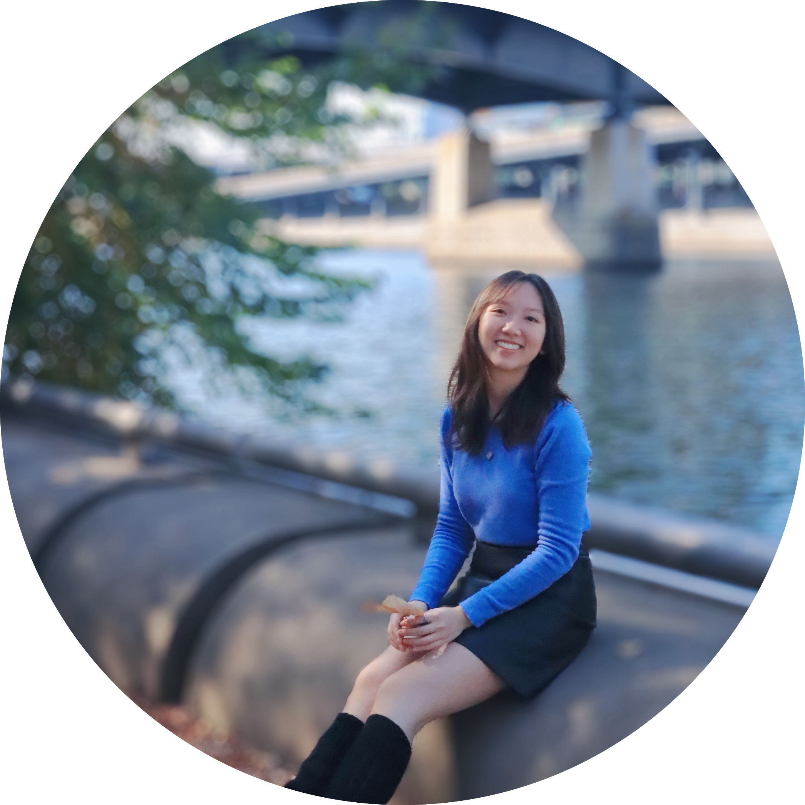
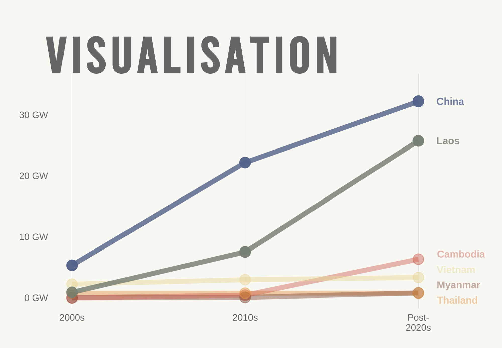
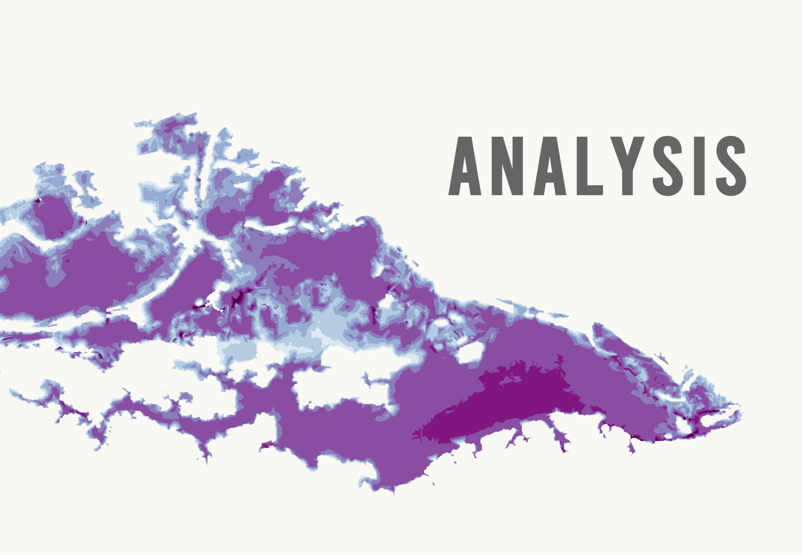
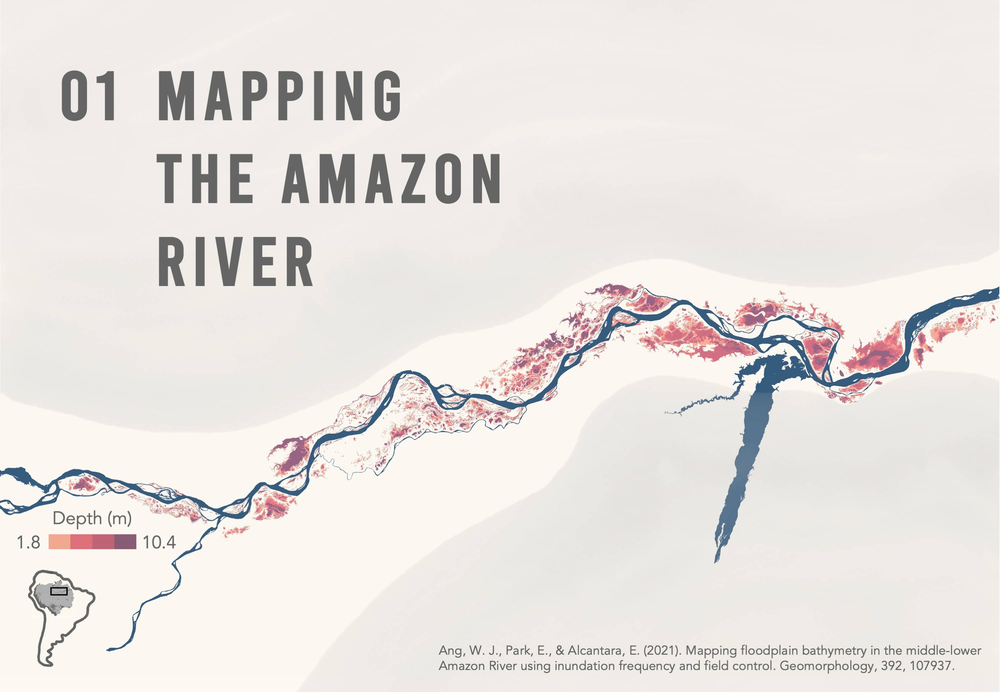
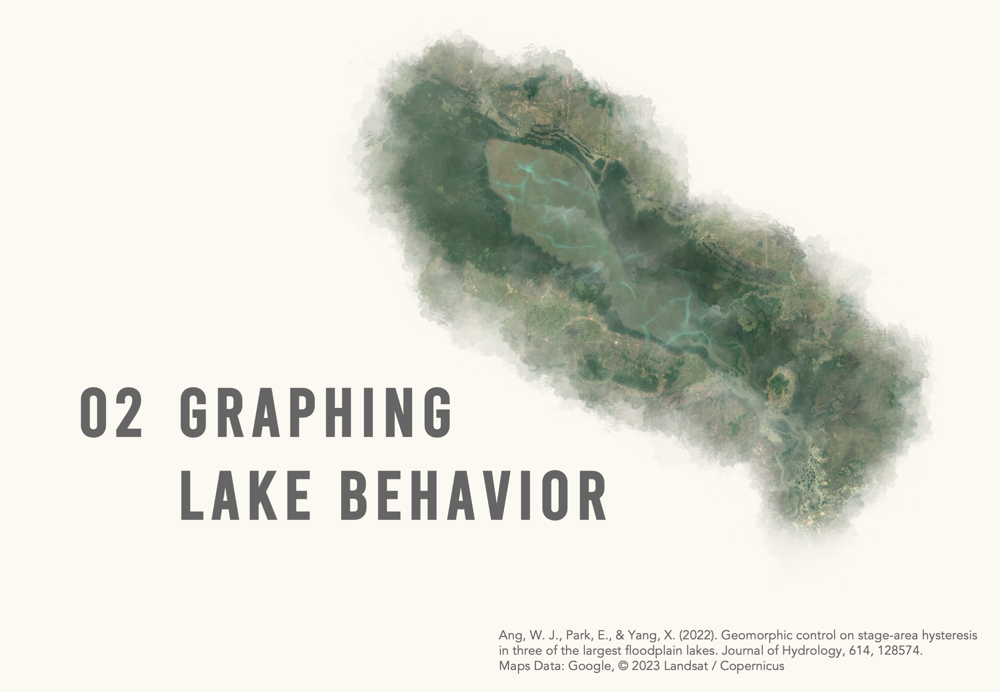
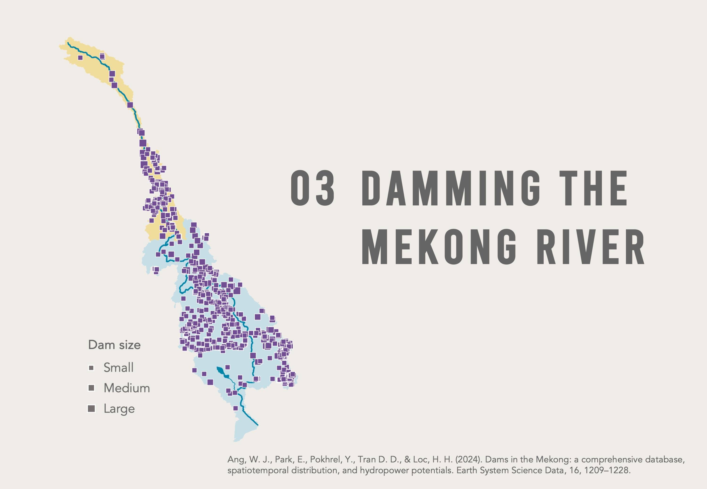
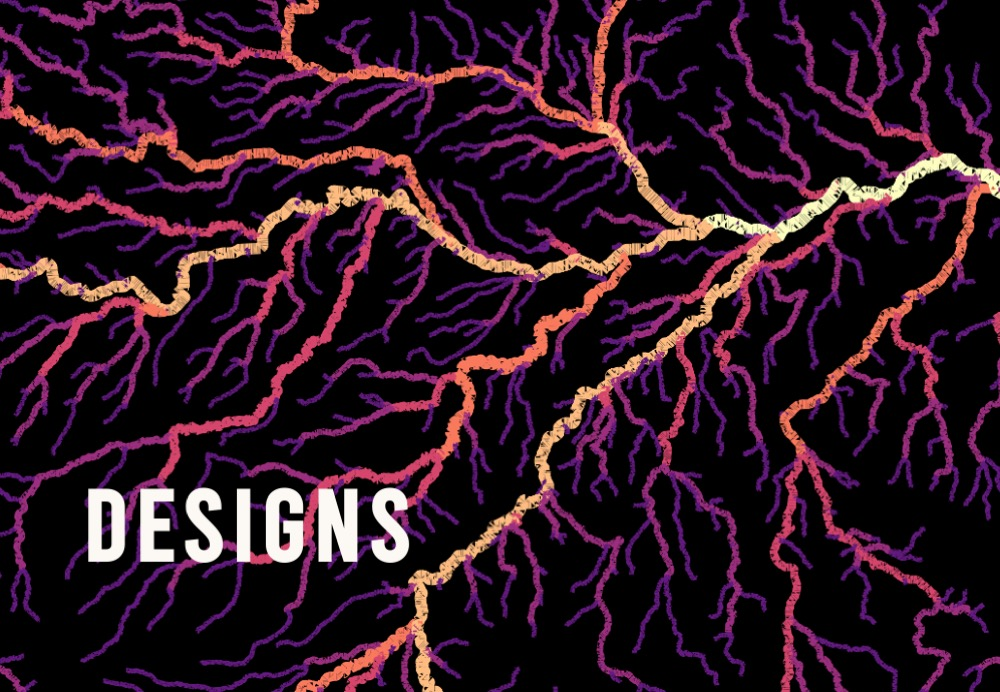
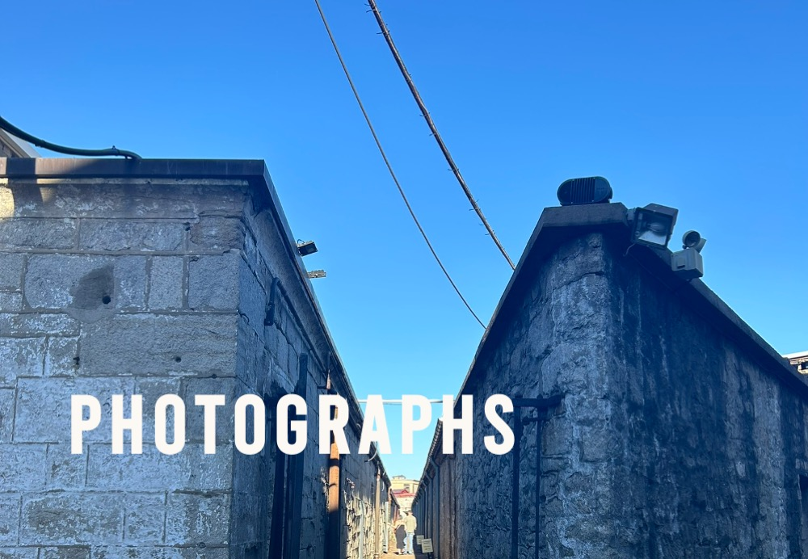
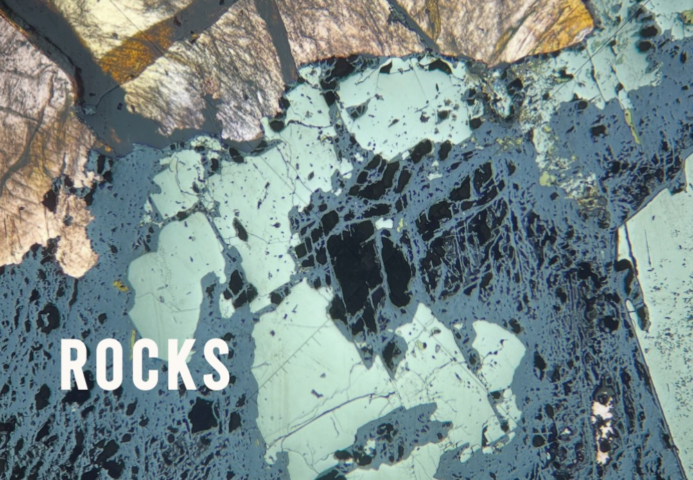

::: {.grid}

::: {.g-col-7} 
# Wei Jing Ang

#### Geospatial Researcher   [Urban Spatial Analytics &nbsp;•&nbsp; Environmental Science]{.subtitle-line}
 

  <a href="https://scholar.google.com/citations?user=uX6hQK4AAAAJ&hl=en&authuser=1&oi=ao" target="_blank">
    <i class="fa-brands fa-google-scholar fa-lg"></i></a> &nbsp;
  <a href="https://www.linkedin.com/in/wei-jing-ang/" target="_blank">
    <i class="fa-brands fa-linkedin fa-lg"></i></a> &nbsp;
  <a href="https://github.com/weijingg" target="_blank">
    <i class="fa-brands fa-github fa-lg"></i></a>

:::

::: {.g-col-5}

{fig-alt="Profile" id="Profile"}

:::

:::
 
I'm a <b>geospatial researcher</b> with a background in urban spatial analytics and environmental science. 
My experience spans <b>remote sensing, hydrology research, urban greenery, and spatial data analysis</b>, supported by three peer-reviewed publications. 
I enjoy translating complex spatial patterns into <b>clear, visually engaging insights</b> that support evidence-based decisions.
 
 

### Projects

::: {.grid}
::: {.g-col-6}

:::

::: {.g-col-6}

:::

:::

### <a href="projects/research/research.qmd" style="color: black; text-decoration: none;">Publications</a>

::: {.grid}
::: {.g-col-4}
{fig-alt="Amazon" id="Amazon"}
:::

::: {.g-col-4}
{fig-alt="Lakes" id="Lakes"}
:::

::: {.g-col-4}
{fig-alt="Mekong" id="Mekong"}
:::

:::

### <a href="collection/index.qmd" style="color: black; text-decoration: none;">Collections</a>

::: {.grid}
::: {.g-col-4}

:::

::: {.g-col-4}

:::

::: {.g-col-4}

:::

:::
